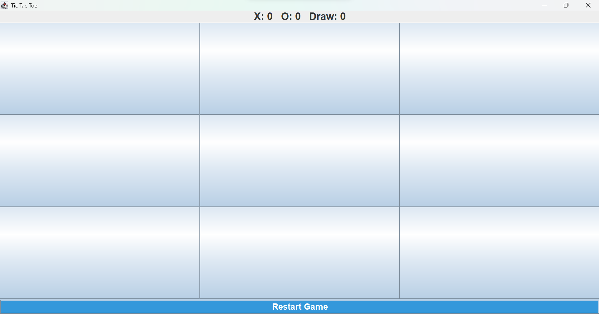

# 🎮 Tic Tac Toe Java Swing

A GUI-based Tic Tac Toe game built using Java Swing and AWT.

## Features

- Interactive 3x3 Game Board
- X and O Turn Management
- Winner Detection
- Draw Detection
- Scoreboard
- Restart Button
- Winning Move Highlight
- Swing-based Graphical User Interface

## Technologies Used

- Java
- Swing
- AWT

## Project Screenshots

### Home Screen

![Gameplays/gameplay.png

### Winner Screen

screenshots/winner.png

### Draw Screen

![Drawshots/draw.png

## How to Run

```bash
javac TicTacToeUI.java
java TicTacToeUI
```

## Project Structure

```text
tic-tac-toe-java-swing
│
├── screenshots
│   ├── game-home.png
│   ├── gameplay.png
│   ├── winner.png
│   └── draw.png
│
├── Game.java
├── TicTacToeUI.java
├── README.md
└── .gitignore
```

## Future Enhancements

- Player Name Input
- Current Turn Indicator
- Undo Move
- Dark Theme
- Best of 3 / Best of 5 Mode
- AI Opponent
- Match History
- Sound Effects

## Author

**Anupam**

GitHub: **Tech-Anupam1234**